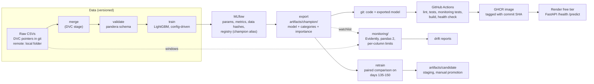

# mlops-tabular-pipeline

An end-to-end ML pipeline for card-transaction fraud detection (IEEE-CIS dataset):
versioned data, a config-driven reproducible pipeline, tracked experiments, a model
registry with a written promotion policy, and tests. A FastAPI service ships as a Docker image through CI/CD to a free-tier host, with drift
monitoring and a local retraining comparison.

## Architecture

Solid arrows are code that runs; dotted arrows are file reads between separate environments. What is not connected is listed in `docs/architecture.md`.

## Status

| phase | state |
|---|---|
| data, EDA, validation, DVC | done |
| baseline and LightGBM, MLflow tracking and registry | done |
| config-driven DVC pipeline | done |
| FastAPI serving, Docker image, CI/CD to GHCR | done |
| cloud deployment (Render free tier) | done |
| drift monitoring (own environment, per-column limits, sensitivity simulation) | done |
| retraining comparison (local; promotion is manual) | done |

## Results (test window, scored once)

Model: LightGBM on raw columns. Random-guess PR-AUC is 0.035 (3.5% fraud).

| metric | validation | test |
|---|---|---|
| PR-AUC | 0.628 | **0.549** |
| ROC-AUC | 0.930 | 0.904 |
| recall @ top 5% | 0.661 | 0.589 |
| precision @ top 5% | 0.459 | 0.409 |

Validation scores are optimistic (early stopping used them). More detail, including
experiments that did not help, is in `docs/results.md`; the decision rules are in
`docs/promotion_policy.md`.

## Reproduce

Requires macOS or Linux, [uv](https://docs.astral.sh/uv/), and Git. Data comes from
Kaggle (the competition rules must be accepted with your own account).

    git clone https://github.com/aadityaa-dava/mlops-tabular-pipeline.git
    cd mlops-tabular-pipeline
    make setup
    # place train_transaction.csv and train_identity.csv from
    # https://www.kaggle.com/c/ieee-fraud-detection/data into data/raw/
    make test && make lint
    make repro

The DVC remote is currently a folder on the author's machine, so `dvc pull` only works
there. A shared remote comes with the cloud-deployment phase. DVC checks the raw files
against the hashes in `data/raw/*.csv.dvc`, so wrong or modified data is detected.

## Serve

Every push to `main` runs lint and tests, builds the image, starts it, checks its health,
scores a request through it, and publishes it to GitHub's container registry tagged with the
commit SHA. To run it locally:

    docker run -p 8000:8000 ghcr.io/aadityaa-dava/mlops-tabular-pipeline:latest
    curl -s localhost:8000/health

The service scores transactions (it returns probabilities; choosing an alert threshold is
left to the caller). Only `TransactionAmt` and `ProductCD` are required, other columns are
optional and a missing value is treated as missing, as in training. Columns the model does
not use (including `isFraud`) are rejected. There is no authentication or rate limiting yet.

The model ships inside the image (`artifacts/champion/`, exported from the registry with
`make export`), so serving needs neither MLflow nor the data. A test confirms the HTTP path
scores 2,000 real validation rows identically to batch scoring.

## Live demo

The service is deployed on Render's free tier from the image CI publishes:

    https://fraud-api-bvtt.onrender.com/health

Things to know before calling it:

- A free instance spins down after 15 minutes without traffic, so the first request after
  a quiet spell can take about a minute.
- It has no authentication or rate limiting: anyone with the URL can call it. It scores
  transactions and returns probabilities; no data is stored.
- The disk is ephemeral, so nothing written by the service survives a restart.
- Redeploys are manual: the service pins one image tag (a commit SHA), and Render does not
  redeploy prebuilt images automatically. See `docs/deployment.md`.

## Monitoring

Drift checks run in `monitoring/`, a separate environment with pandas 2, because Evidently
0.7 does not import under pandas 3 (the main pipeline stays on pandas 3). The two sides share
files, not code: the model export folder lists which features matter
(`feature_importance.json`) and which are categorical (`categories.json`).

    make monitor     compare time windows with a training-period reference
    make simulate    inject controlled shifts and see where the rules start to fire

- It watches the model's 10 highest-gain features. A window alerts when a column's Evidently
  drift score, or the change in its share of missing values, reaches that column's own limit.
  Limits are 1.25x the largest value seen in four training blocks, with floors.
- In the simulation the per-column limits caught a 10% inflation of transaction amounts, a
  shift of 0.1 standard deviations in `C13`, and 5% of rows carrying an unseen email domain.
  A single global threshold needed roughly 50%, 0.25 and 10% for the same three. They missed
  a 5% inflation of amounts.
- Known gaps: a sparse column that stops arriving (`V258`, present in about a quarter of rows)
  is not detected at all; the limits were calibrated on windows inside the reference sample,
  so they are optimistic; and the per-column rule already fires on the validation window
  (`D2`), which may be real drift or a limit that is too tight.
- Feature drift did not predict the performance drop: nothing alerted under the global rule
  when test PR-AUC fell by 0.08. Detecting decay needs labels, which arrive late in
  production.
- The deployed service is not wired to the monitor. Newer images log one JSON line per
  `/predict` call to stdout (aggregates only, no field values), but the live Render service
  runs an older image and its disk is ephemeral.

Details and numbers: `docs/monitoring.md`.

## Retraining

    make retrain     train a candidate on days 0-135, compare it with the champion on days 135-150

Both models are scored on the same rows and the difference in PR-AUC gets a paired bootstrap
interval. The candidate must gain at least 0.02, the interval must exclude zero, recall at the 5%
alert budget may not drop by more than 0.01, and the reloaded model must reproduce its own
scores. The 0.02 comes from a measurement: retraining on the same days with a different seed
moved PR-AUC by +0.0036 (interval -0.0027 to +0.0111), so a 0.01 margin is inside the noise.

Result: champion 0.5257, candidate 0.6135 on days 135-150 (+0.0878, interval +0.0776 to
+0.0981). Read it with its limits: the candidate's training data ends the day before the
comparison window starts, and earlier experiments showed that recency alone is worth about
0.07 PR-AUC, so this mostly shows what fresh data buys. It is one window, and early stopping
used it. The command stops at a staged candidate (`artifacts/candidate/`, git-ignored): the
champion, the registry and the deployed image are not touched, and there is no promote command
on purpose. Retraining runs locally because the data does not exist on any cloud machine.

## Decisions and trade-offs

- **Evaluation.** Time-based split on `TransactionDT` (train days 0-120, validation 120-150,
  test 150-183), PR-AUC as the primary metric, test window scored once. Test PR-AUC is 0.549
  against a random-guess level of 0.035.
- **Features.** Ten engineered row-wise features did not beat seed noise across four seeds
  (mean difference +0.0007), so the production model uses the raw columns.
- **Serving.** The model ships inside the image as a 6 MB exported folder, so the container
  needs neither MLflow nor the data. The cost: a new model means a new image.
- **Monitoring.** Evidently runs in its own pandas 2 environment (see Monitoring). Limits are
  per column, because one global threshold could not separate a 20% inflation of amounts from
  normal variation in other columns.
- **Hosting.** Render's free tier, because AWS, Google Cloud and Azure all asked for a payment
  method at signup in the documentation I read on 2026-10-27, and Hugging Face Docker Spaces
  needed a paid plan. Render's own signup did not ask for a payment method when this was set up.
- **Promotion.** A written, tested rule, and manual replacement of the champion.

## What broke

- **DVC ignored its own pointer files.** A `.gitignore` rule on the whole `data/raw/` folder hid
  the `.dvc` files from DVC's scan, so a bare `dvc pull` said "up to date" and then deleted the
  CSVs. Explicit commands still worked, so only a fresh-clone test exposed it. Ignoring by file
  type fixed it.
- **A silent downgrade.** `uv add mlflow` installed MLflow 1.27.0 (2022), because `pyarrow>=26`
  conflicted with every 3.x release, and it crashed on import. Capping pyarrow fixed it.
- **A tag that does not exist.** `setup-uv@v10` failed the first publish run at job setup.
  Pinning the full version tag fixed it.
- **A wrong port.** Render scanned port 1000 while the app listened on 8000, and the deploy failed
  although the app had started. Setting `PORT=8000` fixed it.
- **A dependency that resolves but cannot import.** Evidently installed cleanly and crashed on
  import under pandas 3.1, and CI did not notice because no test imported it. The fix was a
  separate environment, and the lesson was to run the import before committing the dependency.
- **A rule I overclaimed.** I believed the missing-values check would catch a feed that stops. The
  simulation showed a sparse column (`V258`) losing half its values goes undetected, and the unit
  test had used a column that was 40% missing, which is far easier than the real data.
- **A gain that was seed luck.** Engineered features looked like +0.0067 PR-AUC on seed 42 and
  were indistinguishable from zero over four seeds.
- **A margin inside the noise.** The 0.01 promotion margin turned out to be about the size of the
  seed-to-seed wobble on a 15-day window, which led to the paired rule above.

## Next steps

- Authentication and rate limiting: the public endpoint has neither.
- A shared DVC remote, so cloud jobs can pull data (needs an account and possibly a card).
- Redeploy Render on a newer image, which also turns on prediction logging, and measure a cold start.
- A rule for sparse columns that stop arriving, calibrated per column.
- A fresh holdout and delayed labels, so retraining and decay can be judged on data nobody tuned on.
- A promote command, after more than one comparison window supports it.

## Layout

    configs/config.yaml     all settings (split cutoffs, seed, hyperparameters, MLflow names)
    dvc.yaml                pipeline: merge -> validate -> train
    src/mlops_pipeline/     data, schema, split, features, models, tracking, registry
    tests/                  unit tests
    docs/                   problem framing, EDA findings, results log, promotion policy
    monitoring/             drift monitoring in its own environment (pandas 2, Evidently)
    artifacts/champion/     exported model served by the API
    Dockerfile, .github/    image build and CI/CD

## Honest notes

- Test PR-AUC is about 0.08 below validation, close to the 0.07 drop seen when a
  14-day gap separates training from validation. That suggests recent data matters a lot;
  it does not prove why.
- Engineered row-wise features did not help beyond seed noise and were not adopted.
