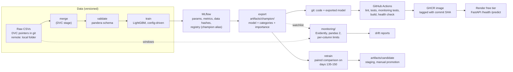

# Architecture

What exists in this repository today and how the pieces connect. Solid arrows are code that runs; dotted arrows are file reads between separate environments.

## What is not connected

- The deployed service does not feed the monitor, and its disk is ephemeral.
- Retraining runs locally and stops at a staged candidate; promoting it to champion, re-registering it in MLflow and redeploying are manual.
- The DVC remote is a folder on one machine, so cloud jobs cannot pull the data.
- Monitoring and retraining read data that only exists locally, so CI tests them with synthetic data, not the real windows.
